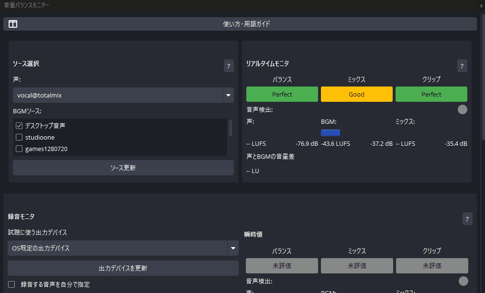
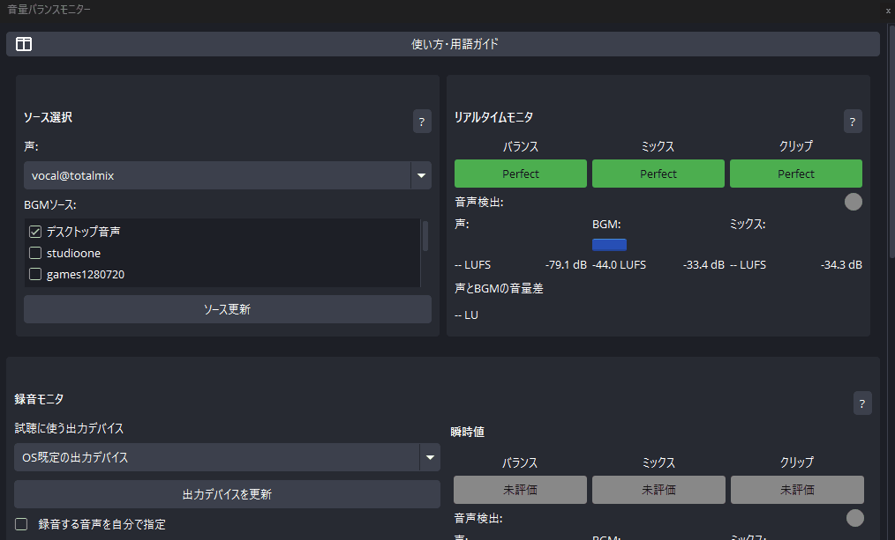

# Loudness Balance Monitor

OBS Studioで声とBGMのラウドネスバランスを確認するプラグインです。ラウドネスとは、人が感じる音の大きさを表す尺度です。

リアルタイムモニタで現在の状態を確認し、録音モニタでOBSの最終ミックスを録音・試聴できます。配信前に声の聞こえやすさや音割れのおそれを確認し、OBSの音量設定を見直す際に使ってください。

## 動作紹介

### リアルタイムモニタ

選択した声とBGMのラウドネス、ピークレベル、バランス評価を表示します。GIFには「使い方・用語ガイド」を開いて閉じる操作も含まれています。



### 録音モニタ

OBSの最終ミックスを録音し、指定した出力デバイスで試聴できます。試聴中の瞬時値と録音全体の数値・評価を表示します。数値の計算対象は、ソース選択で指定した声とBGMです。



## 主な機能

- 声のソース1つとBGMのソースを選択し、ラウドネスとピークレベルを表示します。
- バランス・ミックス・クリップを、緑のPerfect、黄のGood、赤のBadで評価します。声の検出基準と評価基準を調整できます。
- OBSの最終ミックスを最大30秒録音し、指定した出力デバイスで試聴できます。OS既定の出力デバイスも選択できます。
- 録音モニタには瞬時値と録音全体の結果を表示します。
- ドックの幅に合わせて、横に並べる配置と縦に並べる配置を切り替えます。
- ソース選択、評価基準、試聴の設定を保存します。録音した音声は保存せず、OBSの終了時に破棄します。
- 日本語とEnglishに対応しています。操作の説明は各セクションのヘルプと「使い方・用語ガイド」から開けます。

## 評価表示

リアルタイムモニタと録音モニタで、Perfect・Good・Badの表示を共通で使います。次の表は初期設定の評価基準です。バランスとミックスの基準は設定で変更できます。

| 表示 | 色 | バランス: 声とBGMのラウドネス差 | ミックス: 選択した声とBGMのラウドネス | クリップ: 声・BGM・ミックスの最大ピーク |
| --- | --- | --- | --- | --- |
| Perfect | 緑 | +6 LU以上 | -18 LUFS以上 | -1 dBFS未満 |
| Good | 黄 | +3 LU以上、+6 LU未満 | -22 LUFS以上、-18 LUFS未満 | -1 dBFS以上、0 dBFS未満 |
| Bad | 赤 | +3 LU未満 | -22 LUFS未満 | 0 dBFS以上 |

リアルタイムモニタと録音の瞬時値では、バランスとミックスの表示が頻繁に切り替わることを防ぐため、境界の前後0.5 LUで直前の評価を保持します。録音全体の評価には、この保持処理を使いません。録音の測定条件を満たさない場合は「未評価」を表示します。

## 対応環境と配布

対象のOBS Studioバージョンは33.0.1です。Windows・macOS・Linux向けの実装を含み、GitHub Actionsで3OSのビルド、OBSへの読み込み、音声処理を検証しています。

| OS | 配布方法 | 確認範囲 |
| --- | --- | --- |
| Windows x64 | ビルド済みZIP | OBS 33.0.1でユーザーテスト。44.1kHz・48kHzの録音、試聴、数値を検証 |
| macOS | 公開タグのソースからビルド | macOS 26系のarm64 CIでOBSへの読み込みと音声動作を検証。Universalバイナリを生成 |
| Linux | 公開タグのソースからビルド | Ubuntu 26.04 x86_64の公式OBS 33.0.1で読み込みと音声動作を検証 |

macOSのIntel実機と古いOS、Linuxの他ディストリビューションとFlatpak版OBSでは動作を確認していません。CIの仮想音声による検証には、各ユーザーの物理デバイスでの試聴を含みません。検証の詳細は[OBS 33基準環境の報告](docs/reports/2026-11-06-obs33-baseline.md)と[録音モニタの数値・音声検証](docs/reports/2026-11-07-unified-monitor-validation.md)を参照してください。

## インストール

### Windows

1. [Releases](https://github.com/AllegroMoltoV/obs-loudness-balance-monitor/releases)から`loudness-balance-monitor-0.2.0-windows-x64.zip`をダウンロードしてください。
2. OBS Studioを終了し、ZIPを展開してください。
3. ZIP内の`loudness-balance-monitor`フォルダーを`%PROGRAMDATA%\obs-studio\plugins`へコピーしてください。ZIPルートの`include`と`lib`はインストールに使いません。

```text
C:\ProgramData\obs-studio\plugins\
└─ loudness-balance-monitor\
   ├─ bin\64bit\loudness-balance-monitor.dll
   └─ data\locale\
      ├─ en-US.ini
      └─ ja-JP.ini
```

`ProgramData`は隠しフォルダーです。エクスプローラーのアドレス欄へ`%PROGRAMDATA%\obs-studio\plugins`を入力すると開けます。

4. OBS Studioを起動し、メニューの「ドック」→「音量バランスモニター」を選択してください。次回以降の起動時に、OBSの正常終了時に保存したドックの表示状態を復元します。

### macOS・Linux

ビルド済みのインストーラーは配布していません。下記の「ソースからのビルド」に従い、公開タグのソースからビルドして導入してください。

## 使い方

### リアルタイムモニタ

1. ソース選択の「声」と「BGM」に、ラウドネスを比較したいOBSソースを指定してください。
2. 普段の配信と同じように、声とBGMをOBSへ入力してください。
3. リアルタイムモニタのバランス・ミックス・クリップを参考に、OBS側で音量を調整してください。このプラグインには音量の自動調整機能がありません。

### 録音モニタ

1. OBSの配信・録画・リプレイバッファを停止してください。
2. 声とBGMのソース選択を確認し、試聴に使う出力デバイスを選択してください。
3. 「録音する」を押してください。ボタン上の3秒カウントダウン後に録音を開始します。
4. 声とBGMを入力し、確認したい区間を録音したら「録音を終了」を押してください。録音時間の上限は30秒です。発声中の平均を確認するには、3秒より長く録音してください。
5. 録音終了の3秒後に自動で試聴を開始します。外部アプリで音を再生している場合は、試聴時にミュートすることをおすすめします。
6. 試聴音と、瞬時値・録音全体の結果を確認してください。ソース選択や評価基準を変更した結果を確認するには、録り直してください。

既定では配信に使う音声を自動で選びます。別の音声を確認する場合だけ「録音する音声を自分で指定」を有効にしてください。指定する番号は、OBSの「音声の詳細プロパティ」で各ソースを割り当てる音声トラックの番号です。

「試聴中はOBS側のモニタリングをOFF」は初期状態で有効です。試聴中だけOBS標準モニタリングをOFFにし、終了後にこのプラグインが変更した設定を復元します。OBS標準モニタリングと試聴音を同時に聴く場合だけチェックを外してください。この設定で外部アプリやオーディオインターフェースの直接モニターを停止することはできません。

## 数値の対象と制約

試聴する音声と、数値を計算する音声には次の違いがあります。

| 対象 | 内容 |
| --- | --- |
| 試聴音 | 選択した音声トラックのOBS最終ミックス。OBSがソースのフィルターなどを処理して合成した音声 |
| 声・BGMの数値 | ソース選択で指定した声とBGMの音声 |
| 数値表示のミックス | 選択した声とBGMを合成した音声。試聴する最終ミックス全体の測定値ではない |
| 録音の瞬時値 | 試聴位置に対応する短い区間のラウドネスとピークレベル |
| 録音全体 | 発声中の平均ラウドネスと、発声していない区間も含む最大ピークレベル |

選択外のソースやシーンの合成条件によって、表示するミックスの数値と試聴音が異なる場合があります。リアルタイムモニタと録音モニタでも、音声の取得方法と計算方法が異なるため、同一の値になる保証はありません。

録音の瞬時LUFSは400ms区間で計算します。平均LUFSには3秒区間の値と声の検出条件を使うため、短い録音や有効な発声区間がない録音では平均を表示できません。平均LUFSは、録音全体のIntegrated LUFSではありません。

ピークレベルはSample Peakです。True Peakの測定には対応していません。緑・黄・赤の評価は設定した基準による目安であり、聴きやすさを保証するものではありません。

## ソースからのビルド

v0.2.0のソースを取得してください。以降のコマンドは取得したディレクトリで実行してください。

```sh
git clone --branch v0.2.0 https://github.com/AllegroMoltoV/obs-loudness-balance-monitor.git
cd obs-loudness-balance-monitor
```

GitとCMake 3.28以上を用意してください。ビルド時には依存ファイルを取得するため、インターネット接続が必要です。依存するOBSソースとQtなどのバージョンは[buildspec.json](buildspec.json)で固定しています。

### Windows

Visual Studio 2026のC++開発環境とWindows SDK 10.0.26100を用意してください。

```powershell
cmake --preset windows-x64 -DENABLE_POST_BUILD_INSTALL=OFF
cmake --build --preset windows-x64 --config RelWithDebInfo
cmake --install build_x64 --config RelWithDebInfo --prefix release/RelWithDebInfo
```

生成した`release/RelWithDebInfo/loudness-balance-monitor`フォルダーを、前述のWindowsのインストール先へコピーしてください。

### macOS

Xcode 26.5とmacOS SDK 26.5を用意し、`xcode-select`でそのXcodeを選択してください。CMakeがOBS・Qtのビルド用依存ファイルを取得します。

```sh
cmake --preset macos-ci -DENABLE_CCACHE=OFF -DCODESIGN_IDENTITY=- -DCODESIGN_TEAM=
cmake --build --preset macos-ci --config RelWithDebInfo
cmake --install build_macos --config RelWithDebInfo --prefix release/RelWithDebInfo
```

OBSを終了してから、生成したプラグインを配置してください。

```sh
mkdir -p "$HOME/Library/Application Support/obs-studio/plugins"
cp -R release/RelWithDebInfo/loudness-balance-monitor.plugin "$HOME/Library/Application Support/obs-studio/plugins/"
```

この手順はローカルでビルドするためのものです。Developer ID証明書は不要で、生成物にはアドホック署名を使用します。配布用インストーラーの署名・公証を行う手順ではありません。生成対象はarm64・x86_64のUniversalバイナリですが、OBS上の動作確認はarm64です。

### Ubuntu 26.04 x86_64

この手順ではビルド依存パッケージと公式OBS Studio 33.0.1をシステムへ導入します。別の配布元のOBSを使用している環境へ適用する前に、現在の導入構成を確認してください。

```sh
sudo apt-get update
sudo apt-get install -y zsh
zsh .github/scripts/build-ubuntu --target ubuntu-x86_64 --config RelWithDebInfo
```

OBSを終了してからプラグインを導入してください。

```sh
sudo cmake --install build_x86_64 --config RelWithDebInfo --prefix /usr/local
```

主な導入先は次のとおりです。

```text
/usr/local/lib/x86_64-linux-gnu/obs-modules/plugins/loudness-balance-monitor.so
/usr/local/share/obs/obs-modules/plugins/loudness-balance-monitor/locale/
```

Flatpak版OBSへの導入手順には対応していません。

### 依存ライブラリ

ラウドネスの計算には[libebur128](https://github.com/jiixyj/libebur128) v1.2.6を静的リンクしています。libebur128のライセンスはMITです。

---
## v0.2.0の変更

録音モニタ、OS既定の試聴出力、録音の瞬時値・録音全体の評価、幅に応じたドック配置、使い方・用語ガイドを追加しました。ビルドと検証の基準をOBS Studio 33.0.1へ更新しました。

## AI利用開示 / AI Disclosure

### 日本語

v0.1.0までの制作では、Anthropic Claude Codeをソースコード、ビルド設定、テスト、文書を含むほぼすべての工程で使用しました。その後の修正では、OpenAI Codexを同様にほぼすべての工程で使用しました。プロジェクトREADMEとOBS Forum掲載文の作成・改稿にもCodexを使用しています。

作者本人はWindows上のOBS Studioでユーザーテストを実施しました。コード読解による厳密な人間レビューは実施していません。リソースアイコンはClaude Codeが出力したSVGから作成しました。概要説明欄のアニメーションGIFは、作者本人がScreenToGifで画面収録したもので、生成AIを使用していません。

### English

Anthropic Claude Code was used for almost the entire development process through v0.1.0, including source code, build configuration, tests, and documentation. OpenAI Codex was used in a similar capacity for almost all subsequent revisions. Codex was also used to draft and revise the project README and OBS Forum resource description.

The author performed user testing in OBS Studio on Windows but did not perform a rigorous human review of the source code. The resource icon was created from an SVG generated by Claude Code. The animated GIFs in the resource description were screen-recorded by the author using ScreenToGif, without generative AI.

---

## License

GPL-2.0 (same as OBS Studio)

## Author

AllegroMoltoV - [https://www.allegromoltov.jp](https://www.allegromoltov.jp)
